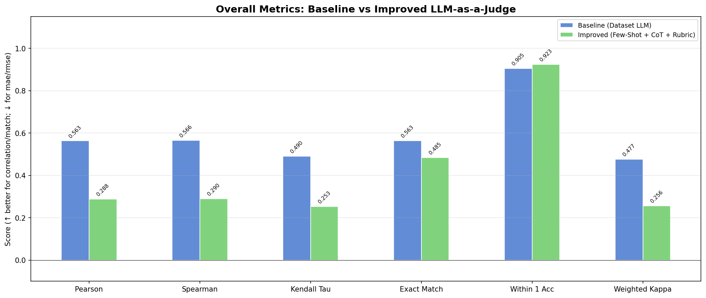

# Báo cáo Đề tài: Đánh giá và Cải tiến LLM-as-a-Judge

## 1. Tổng quan đề tài (Executive Summary / Overview)
- Bối cảnh: Ứng dụng LLM-as-a-Judge trong đánh giá hội thoại chăm sóc khách hàng (Customer Service).
- Mục tiêu: Xây dựng baseline, đánh giá độ tương đồng với con người (Human Alignment) và thiết kế phương pháp cải tiến để nâng cao độ chính xác.

---

## 2. Dữ liệu & Tiền xử lý (Dataset & Preprocessing)
- Mô tả dữ liệu:
  - LLM-as-a-Judge data (`gemini-2.5-flash-customerservice-LLM-as-a-judge-data`).
  - Human evaluation data (3 evaluators độc lập).
- Quy trình tiền xử lý & Merge:
  - Hợp nhất theo `conversation_id`.
  - Tính điểm trung bình (Human Ground Truth) cho 4 tiêu chí: *Human-Likeness, Continuity and Context Understanding, Tone and Clarity, Task Appropriateness*.
- Link: 
  + Human evaluation data:
  https://huggingface.co/collections/Lakshan2003/customer-service-human-evaluation-data-evaluator-3
  (và các evaluator_1, evaluator_2 tương tự)
  + LLM-as-a-Judge data (cùng domain, cùng kiểu conversations):
  https://huggingface.co/collections/Lakshan2003/customer-service-llm-as-a-judge-evaluation-data
---

## 3. Hệ thống Metrics Đánh giá (Evaluation Metrics Framework)

### 3.1. Nhóm tương quan (Correlation Metrics)
- **Pearson Correlation (\(r\))**: Đo lường mối quan hệ tuyến tính giữa điểm của Judge và điểm trung bình của Human. Phản ánh xu hướng tăng/giảm đồng biến giữa hai bên.
- **Spearman Correlation (\(\rho\))**: Đo tương quan thứ bậc (rank-based), ít bị ảnh hưởng bởi phân phối chuẩn hay ngoại lai, phản ánh mức độ nhất quán về thứ tự xếp hạng.
- **Kendall's Tau (\(\tau\))**: Đo mức độ tương đồng về cặp thứ tự (concordant vs. discordant pairs), cung cấp thước đo chặt chẽ về độ tin cậy thứ bậc.

### 3.2. Nhóm sai số (Error Metrics)
- **MAE (Mean Absolute Error)**: Sai số tuyệt đối trung bình giữa điểm Judge và điểm Human:
  $$\text{MAE} = \frac{1}{N} \sum_{i=1}^N |y_{\text{judge}, i} - y_{\text{human}, i}|$$
- **RMSE (Root Mean Squared Error)**: Căn bậc hai sai số bình phương trung bình, phạt nặng hơn các trường hợp sai lệch lớn.

### 3.3. Nhóm độ chính xác & thỏa thuận (Agreement & Concordance)
- **Exact Match Rate**: Tỷ lệ phần trăm điểm số làm tròn của Judge trùng khớp hoàn toàn với điểm làm tròn của Human:
  $$\text{Exact Match} = \frac{1}{N} \sum_{i=1}^N \mathbb{I}(\text{round}(y_{\text{judge}, i}) == \text{round}(y_{\text{human}, i}))$$
- **Within-1 Accuracy**: Tỷ lệ phần trăm điểm số mà Judge chỉ lệch tối đa 1 điểm so với Human ($|y_{\text{judge}} - y_{\text{human}}| \le 1$). Đây là metric thực tế quan trọng trong các bài toán đánh giá thang điểm Likert 1–5.
- **Quadratic Weighted Cohen's Kappa**: Đo lường mức độ đồng thuận giữa hai bên sau khi đã loại trừ yếu tố ngẫu nhiên, áp dụng trọng số bậc hai đối với mức độ chênh lệch điểm.

### 3.4. Nhóm đo độ lệch hệ thống (Systematic Bias)
- **Bias**: Độ lệch trung bình có dấu giữa Judge và Human:
  $$\text{Bias} = \frac{1}{N} \sum_{i=1}^N (y_{\text{judge}, i} - y_{\text{human}, i})$$
  - $\text{Bias} < 0$: Judge chấm khắt khe hơn con người (undervaluation).
  - $\text{Bias} > 0$: Judge chấm nới tay hơn con người (overvaluation).
  - $\text{Bias} \approx 0$: Judge được hiệu chuẩn tốt, tiệm cận thang chuẩn của con người.

---

## 4. Thiết kế & Xây dựng Improved LLM Judge (Proposed Method)

### 4.1. Rubric-based Scoring (Chấm điểm dựa trên Rubric chi tiết)
Thay vì chỉ đưa ra định nghĩa chung của tiêu chí, mô hình cải tiến định nghĩa rõ ràng hành vi và tiêu chuẩn đạt được cho từng thang điểm từ 1 đến 5 trên cả 4 khía cạnh:
- **Human-Likeness**: Phân định từ mức 1 (máy móc, rập khuôn, thô cứng) đến mức 5 (tự nhiên, có sự thấu cảm, không thể phân biệt với nhân viên chăm sóc khách hàng con người).
- **Continuity and Context Understanding**: Quy định rõ mức độ kế thừa và tham chiếu thông tin từ ngữ cảnh hội thoại trước đó (từ mức 1 - bỏ qua ngữ cảnh, đến mức 5 - kết nối mượt mà, chính xác từng chi tiết).
- **Tone and Clarity**: Đánh giá tính rõ ràng, chuẩn mực và phù hợp của giọng điệu theo tình huống khách hàng.
- **Task Appropriateness**: Đo lường trực tiếp mức độ giải quyết trọn vẹn vấn đề mà người dùng đưa ra.

### 4.2. Few-shot Prompting (Mẫu neo điểm chuẩn)
Cung cấp sẵn 3 trường hợp mẫu điển hình đại diện cho 3 dải chất lượng khác nhau:
- **Mẫu chất lượng kém (Low Quality - 1-2 điểm)**: Phản hồi vô thưởng vô phạt, không giải quyết được nhu cầu khách hàng.
- **Mẫu chất lượng trung bình (Medium Quality - 3-4 điểm)**: Phản hồi đúng hướng nhưng còn khô cứng hoặc thiếu cá nhân hóa.
- **Mẫu chất lượng xuất sắc (High Quality - 5 điểm)**: Thấu cảm, viện dẫn đúng mã đơn hàng, giải pháp rõ ràng kèm cam kết hỗ trợ tiếp theo.

Các mẫu này đóng vai trò neo (anchoring) thang điểm, giúp LLM định hình được biên độ chấm điểm chuẩn xác.

### 4.3. Chain-of-Thought (CoT - Suy luận từng bước)
Yêu cầu LLM không xuất điểm trực tiếp mà phải tiến hành phân tích lý do (reasoning) cho từng tiêu chí trước khi chốt điểm số trong khối JSON cuối cùng. Cơ chế này ép mô hình kích hoạt khả năng suy luận logic và đối chiếu từng bằng chứng trong văn bản với rubric.

### 4.4. Self-Consistency (Tổng hợp đa lượt sinh)
Cho phép chạy kiểm tra lặp với nhiệt độ kiểm soát và lấy trung bình các lượt đánh giá, giúp giảm thiểu phương sai và hạn chế tính ngẫu nhiên của các phản hồi đơn lẻ.

---

## 5. Kết quả Thực nghiệm & So sánh (Experimental Results & Comparison)

### 5.1. Bảng so sánh tổng hợp (Overall Metrics)

Bảng dưới đây tổng hợp kết quả macro-average trên toàn bộ các tiêu chí đánh giá giữa mô hình **Baseline** (điểm LLM có sẵn từ tập dữ liệu) và mô hình **Improved Judge** (Few-Shot + CoT + Rubric):

| Metric | Baseline (Existing LLM) | Improved (Few-Shot + CoT + Rubric) | Chênh lệch / Xu hướng |
| :--- | :---: | :---: | :---: |
| **Pearson Correlation** ($r$) | 0.5628 | 0.2885 | Giảm |
| **Spearman Correlation** ($\rho$) | 0.5657 | 0.2897 | Giảm |
| **Kendall's Tau** ($\tau$) | 0.4898 | 0.2526 | Giảm |
| **MAE** ($\downarrow$) | **0.5742** | 0.6071 | Tương đương (+0.0329) |
| **RMSE** ($\downarrow$) | 0.9019 | **0.8925** | **Cải thiện (-0.0094)** |
| **Exact Match Rate** ($\uparrow$) | **0.5630** | 0.4847 | Giảm (-0.0783) |
| **Within-1 Accuracy** ($\uparrow$) | 0.9050 | **0.9235** | **Cải thiện (+1.85%)** |
| **Weighted Kappa** ($\uparrow$) | **0.4767** | 0.2558 | Giảm |
| **Bias** ($\to 0$) | -0.4448 | **-0.0357** | **Cải thiện vượt bậc (tiệm cận 0)** |

---

### 5.2. Kết quả chi tiết theo từng tiêu chí (Per-Criterion Breakdown)

#### A. Mô hình Baseline (`Baseline_Existing_LLM`)
| Tiêu chí | Pearson ($r$) | Spearman ($\rho$) | MAE ($\downarrow$) | Within-1 Acc ($\uparrow$) | Weighted Kappa |
| :--- | :---: | :---: | :---: | :---: | :---: |
| **Human Likeness** | 0.6015 | 0.5811 | 0.2440 | 0.9980 | 0.5528 |
| **Continuity And Context Understanding** | 0.6315 | 0.6450 | 0.9513 | 0.7560 | 0.3179 |
| **Tone And Clarity** | 0.5454 | 0.5211 | 0.2867 | 0.9960 | 0.4949 |
| **Task Appropriateness** | 0.5734 | 0.6626 | 0.8147 | 0.8700 | 0.5015 |

#### B. Mô hình Cải tiến (`Improved_FewShot_CoT_Rubric`)
| Tiêu chí | Pearson ($r$) | Spearman ($\rho$) | MAE ($\downarrow$) | Within-1 Acc ($\uparrow$) | Weighted Kappa |
| :--- | :---: | :---: | :---: | :---: | :---: |
| **Human Likeness** | 0.4831 | 0.4871 | 0.3197 | **1.0000** | 0.3542 |
| **Continuity And Context Understanding** | 0.3230 | 0.3353 | **0.6190** | **0.8571** | 0.2239 |
| **Tone And Clarity** | -0.0625 | -0.0767 | 0.6531 | 0.9592 | -0.0463 |
| **Task Appropriateness** | 0.2425 | 0.2675 | 0.8367 | **0.8776** | 0.2150 |

